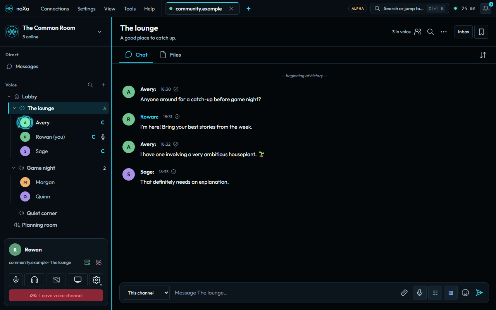

# noXa desktop client

The Wails v2 desktop client connects to the noXa Go server for voice, video,
screen sharing, channel chat and end-to-end encrypted direct/group messages.
Published binaries target **Windows x64**. Linux and macOS have source/platform
support; they do not currently have published desktop release binaries.

- [Website and downloads](https://noxa.wowcraft.pw/)
- Public test server: **`wowcraft.pw`**, default control port `12333`
- [Mobile / browser PWA](https://noxa.wowcraft.pw/app/)
- [Server setup and complete feature reference](../README.md)

## Current interface

The desktop uses **OLED Midnight**, with locally bundled fonts, icons and
notification audio. The top menu contains Connections, Settings, View, Tools
and Help. Windows controls share that bar. The sidebar contains channels and
the current user's voice controls.



- **Connections:** connect/disconnect, server information, bookmarks and
  **PWA / Mobile login**. The mobile dialog provides a QR code, a direct PWA
  link, device/passkey management and platform installation guidance. The
  **noXa Mobile** sidebar shortcut opens the same setup.
- **Settings:** application settings, microphone and playback, camera,
  notifications, hotkeys, whisper lists, identity and local storage. Change
  display name and presence from this menu. Optional remembered passwords use
  the Windows account's OS-protected credential storage.
- **Activity:** mentions, recent accessible conversations, friends, media,
  calls and notifications. Audit is available only with the required server
  permission; the server enforces that access independently of the UI.
- **Chat:** channel/direct-message tabs, replies, reactions, polls, threads,
  files, voice messages, search, Inbox and saved messages. Chat subscriptions
  and voice membership are separate.
- **Voice and video:** channel and private/group calls, explicit camera and
  screen capture, microphone recovery, per-member voice/share-audio controls,
  echo tests and stream diagnostics. Camera capture starts only on request.
  **Screen sharing is native only** (the WebView2 browser picker and
  `getDisplayMedia` are never used for sharing): Windows Graphics Capture, an
  H.264 encoder through Media Foundation and a second, publish-only WebRTC
  peer, with the same end-to-end frame encryption. While a share runs, this
  process gets high GPU scheduling and above-normal CPU priority. Channel
  shares need a server with `native-media-peer-v1`. Without Windows 10 1903+,
  Media Foundation (N editions need the Media Feature Pack), a capable server
  or encrypted voice, the share button stays and its dialog says why sharing
  is not possible. The capture device is created on the GPU that drives the
  captured monitor; encoders are tried in this order: hardware MFTs of that
  adapter (listed by `MFTEnum2` with its LUID; by PCI vendor ID where
  `MFTEnum2` is missing), other hardware MFTs, then the Microsoft software
  H.264 MFT. A hardware encoder
  that ignores the one-slice setting is skipped for the rest of the run and
  the next one opens. A share ends with a notice naming the reason when
  capture fails again after one restart, the encoder keeps producing
  unusable output, the native peer fails after its retries, a viewer cannot
  play H.264, or it stalls: the native peer is not connected 15 s after its
  offer, or viewers want the share but no video packet has left for 10 s
  (never while the share is paused for lack of viewers, its window is
  minimized or no video key is active). `client.log` then has a
  `native share failed` line; `native share stats` lines (2, 5 and 10 s
  after the start, then every minute) count each pipeline stage, and
  `native encoder` lines name the adapter and every encoder tried.
  The picker lists every screen and window as a row with a live thumbnail
  (refreshed about every 1.5 s while the dialog is open), a running game (a
  window covering its monitor) first among the windows, and the last shared
  source preselected (matched by executable and title, then by executable).
  Beside the list it previews the picked source (a still of a screen, a
  window's thumbnail enlarged) above the Area, quality and audio controls.
  With **Area** on, a **Region** is dragged on the picked screen's still and
  cropped on the GPU. **Studio**
  composes its screens, windows and cameras (Media Foundation) with a
  Direct3D 11 compositor in Go; text and images arrive from the webview as
  transparent overlay PNGs, uploaded only on change. In a **private call**,
  the call's screen button opens the same picker; Go then opens one
  relay-only peer-to-peer connection per participant (the call's `screen`
  sub-connection, signaled with the call's sealed signals) and encrypts with
  the call's media keys. It needs no server support, but every participant's
  app must advertise `screen-sub`; otherwise the share is refused with a
  notice (and a running share ends when such a participant joins). Desktop
  clients still show browser screen shares from PWA users.
  Share audio follows the dialog's audio choice: a window share sends only
  that application's audio, a monitor share sends system audio without
  noXa's own voices (WASAPI process loopback, Windows build 20348 or later, i.e. Windows 11). If
  application audio cannot be captured, system audio is shared instead, with
  a notice. Audio is 48 kHz stereo Opus (about 128 kbps), encoded by the
  reference libopus bundled in the exe (`tools/libopus/build.sh` builds it
  reproducibly from the pinned release; BSD license in
  `client/internal/nativecapture/libopus`), encrypted like the browser's share
  audio and timed on the video's capture clock.
- **Tools → Roles:** named roles, hierarchy, member assignments and role icon
  uploads with displayed/enforced limits. Channel access can be synced with a
  parent or customized per role/member.
- **Member menus:** profile, message/call, personal audio, Client Info and
  permitted moderation actions. Only authorized viewers receive privileged
  connection/diagnostic information.

The screenshots are captures of real components with fictional local API
fixtures, not production chats. [Capture and refresh instructions](../website/README.md#product-screenshot-provenance).

## Build and development

Use **Go 1.27.3 or later**, **Node.js 24 or later**, and Wails matching
[`go.mod`](go.mod):

```sh
go install github.com/wailsapp/wails/v2/cmd/wails@v2.17.0
```

Windows requires WebView2. Linux requires the GTK/WebKitGTK and desktop
libraries installed by the [CI workflow](../.github/workflows/ci.yml).

From the repository root:

```sh
npm --prefix client/frontend ci
make client-build
```

Or in Windows PowerShell:

```powershell
./scripts/build.ps1 client
```

Build output is under `client/build/bin/`. Version metadata comes from the
source revision and release tags. Custom builds that use the signed updater
must embed trusted **public** signing keys; see the [root README](../README.md#quick-start).

For frontend/native development, configure a local server using the
[new-server setup](../README.md#new-server-setup), then run `wails dev` from
`client/`. The frontend expects the native Go bridge; opening the desktop
frontend in a browser is not a standalone client. Use `mobile/` for the PWA.

## Checks

From `client/frontend/`:

```sh
npm run quality
npm run test:e2e
```

From the repository root, `make test` runs root/client Go tests and supplies
the embed placeholder needed for source tests. Database-backed tests use a
separate test database. CI also validates Windows, the WebView2 fork, browser
scenarios, race checks and security analysis. Do not point destructive test
fixtures at a production database.

## Identity, privacy and updates

The client keeps settings, identity and logs under the OS user configuration
directory's `noxa` folder. Treat identity exports, local chat data and logs as
private. Import the same identity to recover it; changing a contact's signing
key requires explicit fingerprint confirmation.

The control and file-transfer connections use TLS and pinned server identity.
Direct-message bodies use device-specific recipient keys with X25519 and
XSalsa20-Poly1305; they do not currently use the separate Double Ratchet library
or provide its per-message forward secrecy. Channel messages use server-managed
scope keys. WebRTC channel media is protected in transit to the SFU, without
channel media E2EE. See the root README for the precise encryption boundaries.

A linked phone normally signs in with its saved device key or a passkey.
Trusted desktops automatically endorse passkey-created devices only after
verifying the signed proof. Normal phone sign-out preserves its passkeys; the
first/master device cannot be remotely signed out from another device.

The updater verifies a signed manifest and artifact hash, then supervises
restart. Failed startup restores the previous executable, without rolling back
identity, settings or message history. Keep recovery copies of important local
data independently of application updates.
